# Atividade Serverless — Rota Vital: geração de guia de transporte

Atividade individual de **Infraestrutura de Software (CESAR School)** sobre computação *serverless*.

A ideia é rodar uma função AWS Lambda **localmente**, com o AWS SAM CLI e o Docker, e observar na prática três coisas:
o *cold start* (fase de Init), o reaproveitamento do ambiente de execução (*warm containers*) e o limite de tempo (*Timeout*).

**A função:** no contexto do **Rota Vital** (transporte de bolsas de sangue entre hemocentro e hospitais), ela recebe uma
**requisição** por `POST /guias` e gera a **guia de transporte** dessa requisição:

```json
// entrada
{"requisicaoId": "R-001", "hospital": "H-Recife", "bolsas": ["O-NEG-0142"]}
// saída (HTTP 201)
{"guia": "G-R-001", "hospital": "H-Recife", "bolsas": ["O-NEG-0142"], "invocacaoNesteAmbiente": 1}
```

- Sem `requisicaoId`, ela responde **400**.
- Com `"demorar": true`, ela dorme 5 s, o que passa do Timeout de 3 s.
- `invocacaoNesteAmbiente` é um contador em **variável global**. Ele mostra se o mesmo ambiente (container) foi reaproveitado.

## Caminho escolhido

**Caminho A: AWS SAM CLI rodando localmente, sem conta AWS**, no **macOS** (MacBook Apple Silicon, `arm64`) com Docker Desktop.

## Estrutura

```
.
├── README.md
├── evidencias/                 # saídas reais dos comandos (ver seção Evidências)
│   ├── prints/                 # prints de tela
│   ├── logs/                   # logs completos do sam local start-api
│   └── extra/
└── rota-vital-guia/            # projeto SAM (gerado com sam init)
    ├── template.yaml           # POST /guias, Timeout (3 → 10), arm64
    ├── samconfig.toml
    ├── hello_world/app.py      # a função
    ├── events/pedido.json      # evento do API Gateway para o sam local invoke
    └── tests/unit/             # testes unitários (pytest)
```

## Pré-requisitos

| Ferramenta     | Versão usada | Instalação                    |
|----------------|--------------|-------------------------------|
| Docker Desktop | 29.9.2       | já instalado; precisa estar **aberto** |
| AWS SAM CLI    | 1.174.0      | `brew install aws-sam-cli`    |
| Python         | 3.12.16      | `brew install python@3.12`    |
| Homebrew       | —            | https://brew.sh               |

Não precisa de conta AWS nem de credenciais. Saída real: [`evidencias/01-versoes.txt`](evidencias/01-versoes.txt).

## Como rodar

### 0. Ambiente

```bash
docker info > /dev/null && echo "Docker OK"   # se falhar: abra o Docker Desktop
brew install aws-sam-cli python@3.12
sam --version; docker --version; python3.12 --version
uname -m                                        # arm64 = Apple Silicon; x86_64 = Intel
export SAM_CLI_TELEMETRY=0                      # opcional: desliga a telemetria do SAM
```

### 1. Criar o projeto (já está feito neste repositório)

```bash
sam init --name rota-vital-guia --runtime python3.12 --app-template hello-world \
  --package-type Zip --dependency-manager pip --architecture arm64 \
  --no-tracing --no-application-insights --no-structured-logging
```

Depois disso:

- no `template.yaml`: `Path: /hello` → `/guias`, `Method: get` → `post`, `Globals.Function.Timeout: 3`;
- `hello_world/app.py` foi substituído pelo código da atividade;
- os testes foram ajustados: o unitário foi reescrito para o novo código e o de integração foi removido, porque ele exige uma stack implantada na AWS;
- **atenção:** o `samconfig.toml` gerado pelo SAM 1.174 vinha com `warm_containers = "EAGER"` para `local start-api`. Isso foi removido, senão o teste "sem warm" sai errado (ver Resultados).

Testes unitários (opcional):

```bash
cd rota-vital-guia
python3.12 -m venv .venv && .venv/bin/pip install -r tests/requirements.txt
.venv/bin/python -m pytest tests/unit -v       # 4 passed
```

### 2. Invocar com evento (`sam local invoke`)

```bash
cd rota-vital-guia
sam local generate-event apigateway aws-proxy --method POST --path guias \
  --body '{"requisicaoId":"R-001","hospital":"H-Recife","bolsas":["O-NEG-0142"]}' > events/pedido.json
```

> O SAM 1.174 gera o `body` em **base64** (`"isBase64Encoded": true`), e a função faz `json.loads(body)` direto.
> Por isso decodifiquei o body, que é como o API Gateway entrega um JSON de verdade:
>
> ```bash
> python3.12 -c "import json,base64;p='events/pedido.json';e=json.load(open(p));e['body']=base64.b64decode(e['body']).decode() if e['isBase64Encoded'] else e['body'];e['isBase64Encoded']=False;json.dump(e,open(p,'w'),indent=2)"
> ```
>
> O `events/pedido.json` deste repositório já está corrigido.

```bash
sam build
time sam local invoke -e events/pedido.json    # 1ª vez
time sam local invoke -e events/pedido.json    # 2ª vez
```

### 3. Gatilho HTTP (`sam local start-api`)

> Usei `--port 3001` porque a porta 3000 do meu Mac já estava ocupada por outro programa.
> Se a sua estiver livre, pode tirar o `--port 3001` e usar `:3000` nos curls.

```bash
# terminal 1: SEM warm containers (um container novo por requisição)
sam local start-api --port 3001

# terminal 2: rodar 3 vezes
curl -s -X POST http://127.0.0.1:3001/guias -H "Content-Type: application/json" \
  -d '{"requisicaoId":"R-002","hospital":"H-Caruaru"}'
```

Pare com `Ctrl+C` e repita **COM** warm containers:

```bash
sam local start-api --port 3001 --warm-containers LAZY
# e os mesmos 3 curls
```

### 4. Limite de tempo (Timeout)

Com `Timeout: 3` no `template.yaml` e o `start-api` rodando:

```bash
curl -s -X POST http://127.0.0.1:3001/guias -H "Content-Type: application/json" \
  -d '{"requisicaoId":"R-003","demorar":true}'
```

Depois mude para `Timeout: 10` no `template.yaml`, rode `sam build`, reinicie o `start-api` e repita o curl.

> O repositório está no **estado final** (`Timeout: 10`). Para reproduzir o erro, volte para `Timeout: 3` e rode `sam build`.

## Resultados

Todos os números abaixo são reais, tirados das execuções de 24/11/2026 (arquivos em `evidencias/`).

### Invocação com evento (`sam local invoke`)

| Invocação | Tempo total (`time`, real) | Duration | Init Duration | `invocacaoNesteAmbiente` | Evidência |
|-----------|---------------------------:|---------:|--------------:|:------------------------:|-----------|
| 1ª        | **50,30 s**                | 336,18 ms | 0,03 ms      | 1 | [`02-invoke-1.txt`](evidencias/02-invoke-1.txt) |
| 2ª        | **5,03 s**                 | 377,50 ms | 0,04 ms      | 1 | [`03-invoke-2.txt`](evidencias/03-invoke-2.txt) |

- Na 1ª invocação o SAM não tinha a imagem do runtime (`Local image was not found` → `Building image....`). Ele baixou e montou a imagem `public.ecr.aws/lambda/python:3.12-rapid-arm64`, e foi isso que gastou ~45 s a mais.
- Na 2ª a imagem já existia (`Local image is up-to-date`).
- O `Init Duration` do emulador local fica perto de zero e **não representa** o cold start real da AWS. Quem mostra o custo da inicialização aqui é o tempo total.
- `sam local invoke` sempre cria um container novo, então o contador foi **1 nas duas**.

### Gatilho HTTP: `invocacaoNesteAmbiente` com e sem warm containers

| Chamada | Sem `--warm-containers` | Com `--warm-containers LAZY` |
|--------:|:-----------------------:|:----------------------------:|
| 1       | **1** (3,51 s)          | **1** (4,92 s, com Init)     |
| 2       | **1** (1,91 s)          | **2** (1,03 s)               |
| 3       | **1** (2,82 s)          | **3** (0,02 s)               |

Evidências: [`04-http-sem-warm.txt`](evidencias/04-http-sem-warm.txt) e [`05-http-com-warm.txt`](evidencias/05-http-com-warm.txt).
Os logs completos estão em `evidencias/logs/`.

- **Sem warm**, cada requisição subiu um container novo. O contador sempre recomeça em 1, e todas as chamadas levaram segundos.
- **Com LAZY**, o container foi criado na 1ª chamada e reaproveitado depois. O contador foi 1 → 2 → 3, e só a 1ª teve `Init Duration` no log. A 3ª chamada levou 20 ms no total.
- **Achado extra:** na primeira tentativa "sem warm" o contador deu 1, 2, 3. A causa era o `samconfig.toml` gerado pelo template, que já vinha com `warm_containers = "EAGER"`. Removi essa linha e refiz o teste. A rodada errada está guardada em [`extra/04x-http-samconfig-eager-padrao.txt`](evidencias/extra/04x-http-samconfig-eager-padrao.txt).

### Limite de tempo

| Configuração | Requisição         | Resultado | Log |
|--------------|--------------------|-----------|-----|
| `Timeout: 3`  | `"demorar": true` | **HTTP 502** `{"message":"Internal server error"}` em 3,13 s | `Function 'HelloWorldFunction' timed out after 3 seconds`, `Duration: 3000.00 ms` |
| `Timeout: 10` | `"demorar": true` | **HTTP 201** `{"guia": "G-R-003", ...}` em 9,81 s | `Duration: 5245.19 ms` |

Evidências: [`06-timeout-3s.txt`](evidencias/06-timeout-3s.txt) e [`07-timeout-10s.txt`](evidencias/07-timeout-10s.txt).

## Respostas

**1. Por que a primeira invocação demorou mais que a segunda? O que acontece na fase de Init?**

A primeira demorou 50,3 s e a segunda 5,0 s. Na primeira o ambiente ainda não existia: o SAM teve que baixar e montar a imagem do runtime Python antes de rodar qualquer coisa. Isso é um *cold start*. Na fase de **Init**, o Lambda cria o ambiente de execução (container/microVM), carrega o runtime, baixa o código e roda tudo que está fora do handler (os `import` e a variável global `contador = 0`). Só depois disso o handler é chamado. Na segunda vez a imagem já estava pronta, então sobrou só o tempo de subir o container e executar. A função em si foi rápida nas duas (~340 ms de Duration).

**2. O que o campo `invocacaoNesteAmbiente` mostrou com e sem `--warm-containers`? O que isso diz sobre guardar estado numa variável global?**

Sem warm deu 1, 1, 1, porque cada requisição ganhou um container novo e a variável global voltou a 0. Com `--warm-containers LAZY` deu 1, 2, 3, porque o mesmo container foi reaproveitado e a variável global continuou na memória. Conclusão: a variável global **só sobrevive se o ambiente for reaproveitado**, e quem decide isso é a plataforma, não eu. Ela serve como cache (por exemplo, guardar uma conexão aberta), mas não para guardar estado importante como contadores, pedidos ou sessões. Isso tem que ir para um banco ou fila (DynamoDB, RDS, S3, SQS). Até o meu `samconfig.toml` ligou warm containers sem eu pedir, o que mostra que não dá para contar com esse comportamento.

**3. O que aconteceu com `demorar = true`? Qual o tempo máximo de uma execução no Lambda e o que fazer com trabalho mais longo?**

Com Timeout de 3 s, a função foi interrompida em exatamente 3000 ms ("timed out after 3 seconds") e o cliente recebeu **HTTP 502**. A guia não foi gerada. Com Timeout de 10 s, ela terminou em ~5,2 s e voltou **201**. No Lambda o tempo máximo de uma execução é **15 minutos (900 s)**. Para trabalho mais longo, a saída é quebrar ou mudar de serviço:

- **Step Functions** para orquestrar várias etapas curtas;
- **SQS com workers** para processar em filas e lotes;
- **ECS/Fargate** para containers que rodam o tempo que precisarem;
- **AWS Batch** para jobs pesados.

**4. Custo de 1 milhão de execuções com 128 MB e 100 ms (us-east-1, sem plano gratuito)**

| Parte | Conta | Valor |
|-------|-------|------:|
| Requisições | 1.000.000 × US$ 0,20 / 1.000.000 | **US$ 0,20** |
| Computação (GB-s) | 0,125 GB × 0,1 s × 1.000.000 = **12.500 GB-s** | |
| | 12.500 GB-s × US$ 0,0000166667 | **≈ US$ 0,21** |
| **Total** | 0,20 + 0,21 | **≈ US$ 0,41** |

(128 MB = 0,125 GB.) Ou seja, 1 milhão de guias custaria menos de meio dólar, porque só se paga quando a função roda.

**5. Em que parte do Rota Vital uma função assim faz sentido e em qual não faz?**

Faz sentido em **tarefas curtas e disparadas por evento**: gerar a guia quando chega uma requisição, validar a requisição (como o 400 sem `requisicaoId`), notificar o hospital de que a bolsa saiu. São coisas que duram milissegundos, acontecem em picos e não precisam de servidor ligado o tempo todo.

**Não** faz sentido no **rastreamento em tempo real** do transporte. Ali há conexão aberta contínua (WebSocket/GPS mandando posição o tempo todo) e estado que precisa ficar vivo, e o Lambda tem limite de 15 min e pode perder a memória a qualquer momento (como vimos no item 2). Para isso é melhor um serviço sempre ligado (ECS/Fargate, por exemplo), com o estado guardado num banco.

## Evidências

| Arquivo | Conteúdo |
|---------|----------|
| [`evidencias/01-versoes.txt`](evidencias/01-versoes.txt) | versões do SAM, Docker, Python e arquitetura |
| [`evidencias/02-invoke-1.txt`](evidencias/02-invoke-1.txt) | 1ª `sam local invoke` (com `time`) |
| [`evidencias/03-invoke-2.txt`](evidencias/03-invoke-2.txt) | 2ª `sam local invoke` (com `time`) |
| [`evidencias/04-http-sem-warm.txt`](evidencias/04-http-sem-warm.txt) | 3 curls sem warm containers |
| [`evidencias/05-http-com-warm.txt`](evidencias/05-http-com-warm.txt) | 3 curls com `--warm-containers LAZY` |
| [`evidencias/06-timeout-3s.txt`](evidencias/06-timeout-3s.txt) | `demorar: true` com Timeout 3 (resposta + log do erro) |
| [`evidencias/07-timeout-10s.txt`](evidencias/07-timeout-10s.txt) | `demorar: true` com Timeout 10 (201) |
| [`evidencias/logs/`](evidencias/logs/) | logs completos de cada `sam local start-api` |
| [`evidencias/extra/`](evidencias/extra/) | rodada com o `samconfig.toml` em EAGER (achado extra) |

### Prints

Imagens geradas a partir dos arquivos `.txt` acima com o [freeze](https://github.com/charmbracelet/freeze)
(`brew install charmbracelet/tap/freeze`), todas em [`evidencias/prints/`](evidencias/prints/):

```bash
for f in evidencias/*.txt evidencias/extra/*.txt; do
  freeze "$f" -o "evidencias/prints/$(basename "$f" .txt).png" --language bash --window --wrap 110
done
```

#### 1. Ambiente: versões das ferramentas
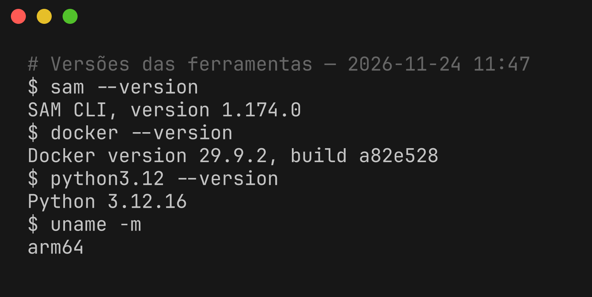

#### 2. `sam local invoke`, 1ª invocação (50,30 s no total, baixando a imagem)
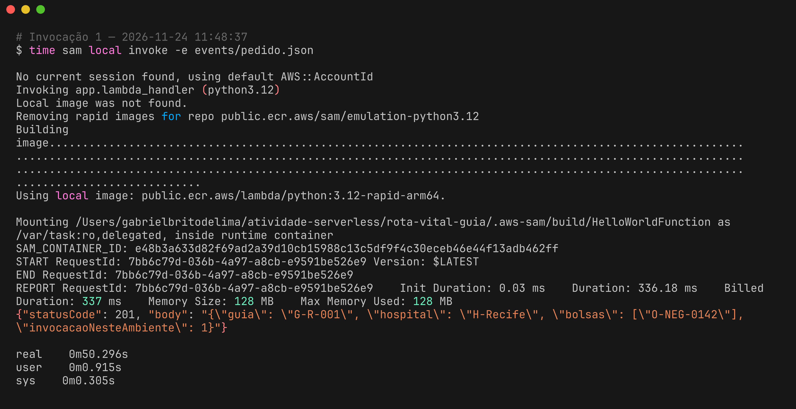

#### 3. `sam local invoke`, 2ª invocação (5,03 s no total)
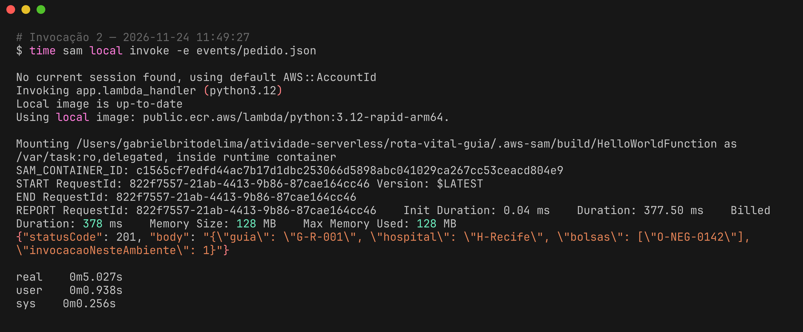

#### 4. HTTP sem `--warm-containers` (contador 1, 1, 1)
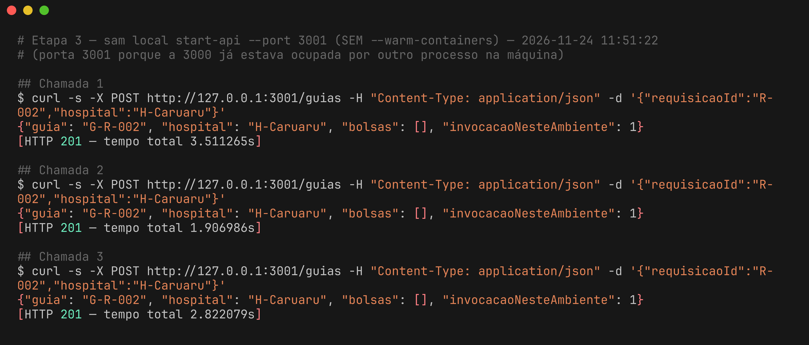

#### 5. HTTP com `--warm-containers LAZY` (contador 1, 2, 3)
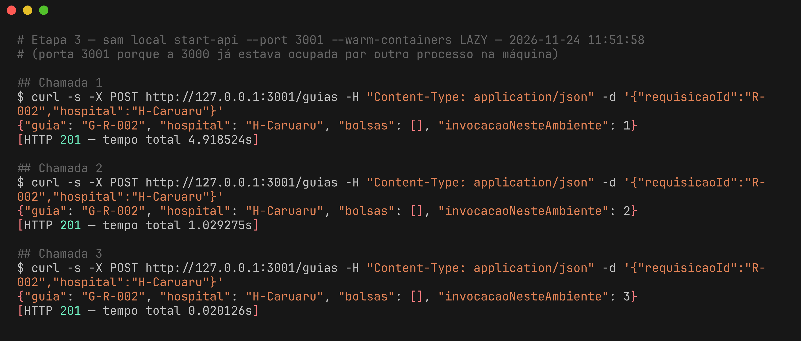

#### 6. Timeout 3 s com `demorar: true` (HTTP 502, "timed out after 3 seconds")
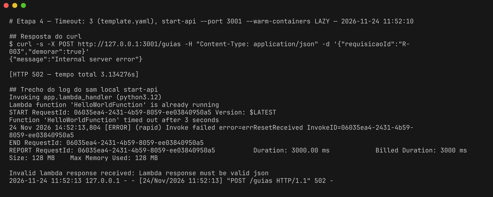

#### 7. Timeout 10 s com `demorar: true` (HTTP 201)
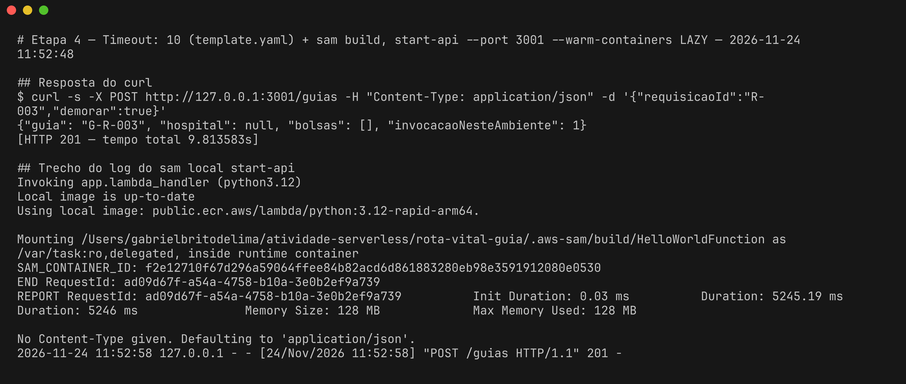

#### Extra: `samconfig.toml` com `warm_containers = "EAGER"` padrão (contador 1, 2, 3 sem pedir warm)
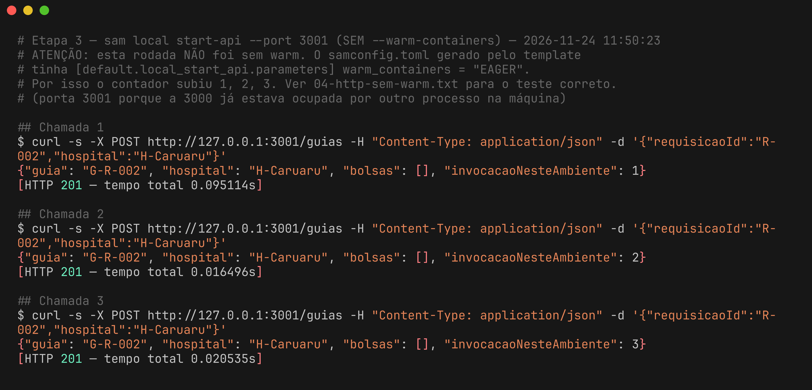

### Vídeo

🎥 **Link do vídeo:** _(colocar aqui o link do vídeo, até 3 min)_

O vídeo (2min20) foi gerado com o [VHS](https://github.com/charmbracelet/vhs) a partir do roteiro
[`video/entrega.tape`](video/entrega.tape). O VHS abre um terminal de verdade, digita e **executa os comandos reais
do projeto** (`sam local invoke`, `sam local start-api`, `curl`, `sam build`) e grava a tela. Nenhuma saída é simulada:
os números que aparecem no vídeo são os da execução daquele momento. Ele mostra:

1. a invocação com evento (`sam local invoke`, duas vezes, com `time`);
2. a chamada HTTP com `curl`, sem warm containers (contador 1, 1, 1) e com `--warm-containers LAZY` (1, 2, 3);
3. o erro de tempo limite (Timeout 3 → `Internal server error` + "timed out after 3 seconds" no log) e o ajuste
   (Timeout 10 + `sam build` → 201).

Para gerar de novo (com o Docker aberto, `Timeout: 3` no `template.yaml` e `sam build` feito):

```bash
brew install vhs
vhs video/entrega.tape        # gera video/entrega-serverless.mp4 (o .mp4 não é versionado)
```

Quadros extraídos do vídeo com `ffmpeg`:

| Parte | Quadro |
|-------|--------|
| 0. Título | 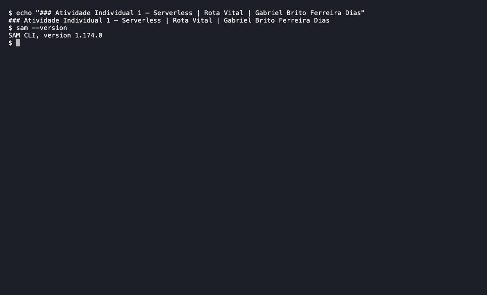 |
| 1. Invocação com evento | 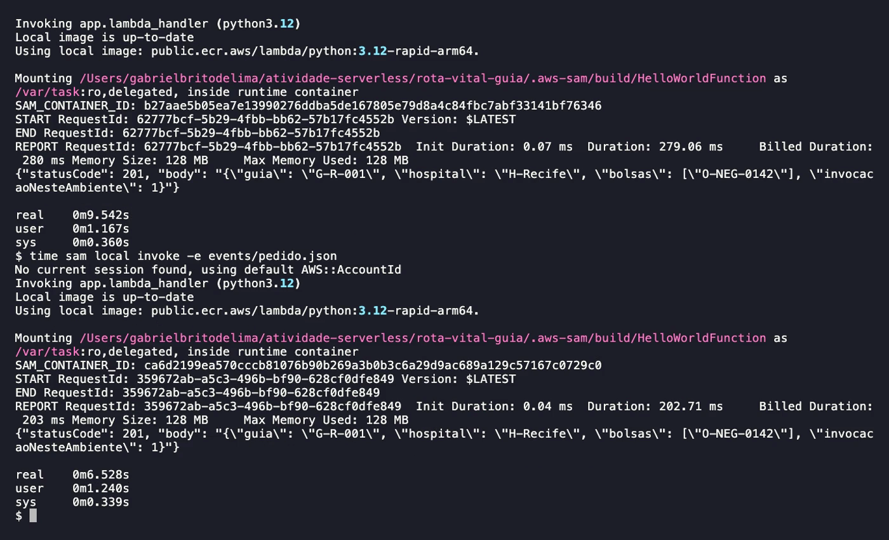 |
| 2a. HTTP sem warm (1, 1, 1) | 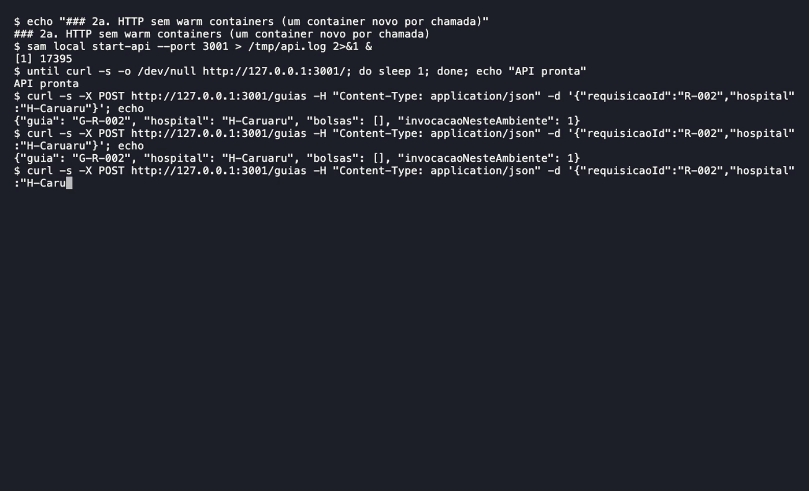 |
| 2b. HTTP com warm LAZY (1, 2, 3) | 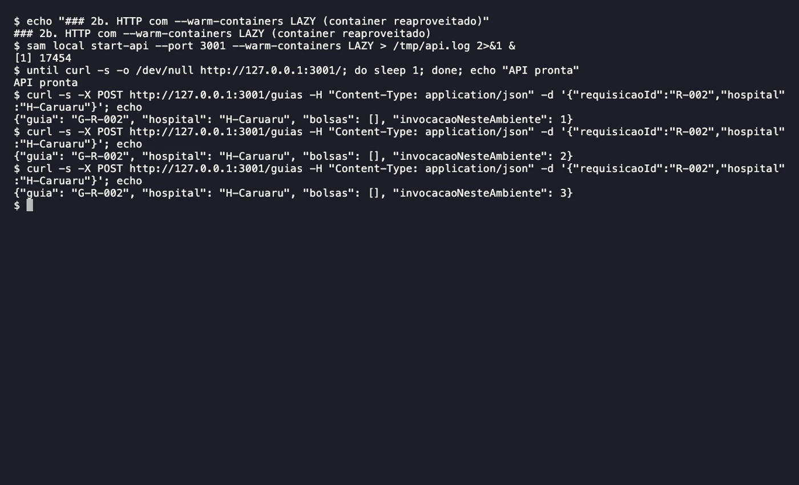 |
| 3. Timeout 3 s | 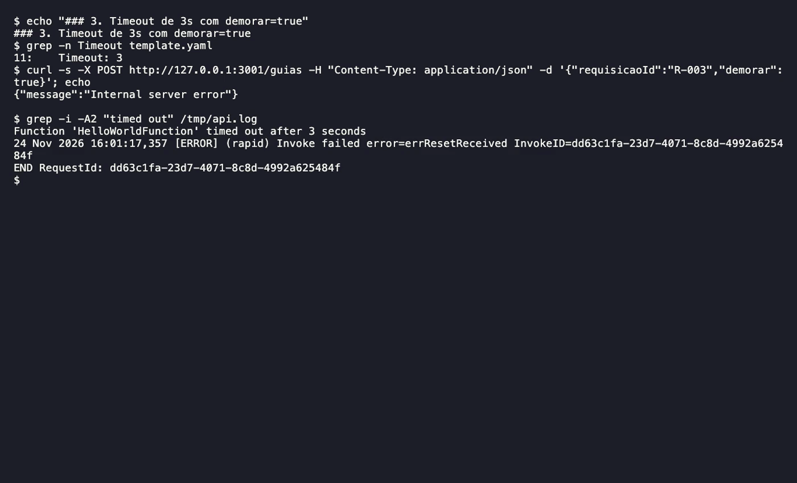 |
| 3b. Timeout 10 s → 201 | 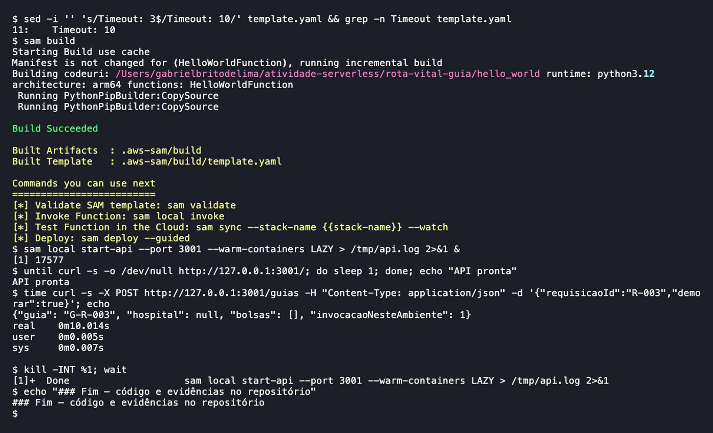 |

## Uso de IA

- **Ferramenta:** Claude Code (Anthropic).
- **Finalidade:** montar o projeto, rodar os comandos, gerar as evidências e rascunhar este README.
- **Validação:** executei e conferi as saídas, revisei e reescrevi as respostas com minhas palavras (PO-CESAR-021).
